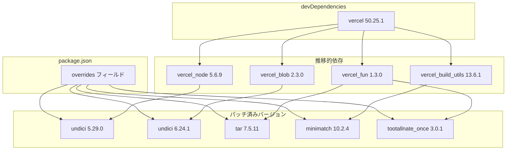

# 設計ドキュメント: security-dependency-updates

## Overview

本フィーチャーは、`vercel` devDependency の推移的依存として混入している 4 パッケージ（undici, tar, minimatch, @tootallnate/once）のセキュリティ脆弱性 10 件をすべて解消する。

**Purpose**: GitHubのDependabotが検出したopenアラートを解消し、og-imageサービスの供給チェーンセキュリティを回復させる。

**Users**: サービス運営者（セキュリティコンプライアンスの維持義務を持つ）が対象。

**Impact**: `package.json` に `overrides` フィールドを追加し `npm install` を再実行することで `package-lock.json` を更新する。本番コード（`api/`, `web/`）への変更は一切発生しない。

### Goals

- Dependabot open アラート #5, #6, #8, #12, #13, #14, #15, #17, #18, #21 の全件解消
- `npm audit` でゼロ脆弱性を達成（open アラート対象）
- 既存のOGP画像生成機能の動作継続を保証

### Non-Goals

- `vercel` 本体のバージョンアップグレード（リスクに対し効果なし）
- auto_dismissed アラート（#7, #9, #10, #11, #19, #20）および fixed アラート（#1, #2, #3）の対応
- 本番コード（API ロジック・テンプレート・フロントエンド）への機能追加・変更

---

## Architecture

### Existing Architecture Analysis

og-image は単一の `package.json` を持つ Node.js 24.x プロジェクト。`vercel` は devDependency として CLI ツール用途で使用されており、本番ランタイムとは無関係。脆弱パッケージはすべて `vercel` のサブパッケージ内に留まり、`api/` や `web/` のランタイムコードには到達しない。

### Architecture Pattern & Boundary Map



**Architecture Integration**:
- Selected pattern: `npm overrides`（ネスト形式 + フラット形式の組み合わせ）
- `undici` のみネスト形式で依存元（@vercel/node / @vercel/blob）ごとに異なるメジャーバージョンを維持
- 他 3 パッケージはフラット指定（単一メジャーバージョンで問題なし）
- 既存パターン保持: 本番コード・vercel 設定・TypeScript 設定は無変更

### Technology Stack

| Layer | Choice / Version | Role in Feature | Notes |
|-------|------------------|-----------------|-------|
| パッケージ管理 | npm（Node.js 24.14.0 同梱） | overrides によるバージョン強制 | `package.json` の `overrides` フィールド |
| ランタイム | Node.js 24.14.0 (Volta) | `npm install` / `npm ci` 実行 | 既存バージョン据え置き |
| 推移的依存 | undici 5.29.0 / 6.24.1 | HTTP クライアント（vercel CLI 内部） | ネスト overrides で 2 バージョン共存 |
| 推移的依存 | tar 7.5.11 | アーカイブ処理（@vercel/fun 内部） | フラット overrides |
| 推移的依存 | minimatch 10.2.4 | glob マッチング（@vercel/build-utils 内部） | フラット overrides |
| 推移的依存 | @tootallnate/once 3.0.1 | イベント制御（@vercel/fun 内部） | フラット overrides |

---

## Requirements Traceability

| Requirement | Summary | Components | Interfaces | Flows |
|-------------|---------|------------|------------|-------|
| 1.1, 1.2, 1.3, 1.4 | undici 脆弱性解消 | DependencyOverridesConfig | npm overrides（ネスト形式） | npm install → package-lock.json 再生成 |
| 2.1, 2.2, 2.3, 2.4 | tar 脆弱性解消 | DependencyOverridesConfig | npm overrides（フラット形式） | 同上 |
| 3.1, 3.2, 3.3, 3.4 | minimatch 脆弱性解消 | DependencyOverridesConfig | npm overrides（フラット形式） | 同上 |
| 4.1, 4.2, 4.3, 4.4 | @tootallnate/once 脆弱性解消 | DependencyOverridesConfig | npm overrides（フラット形式） | 同上 |
| 5.1, 5.2, 5.3, 5.4, 5.5 | 更新後の動作継続性 | VerificationStep | `npm audit` / `vercel dev` / `npm run build` | 手動検証フロー |

---

## Components and Interfaces

| Component | Domain/Layer | Intent | Req Coverage | Key Dependencies | Contracts |
|-----------|--------------|--------|--------------|------------------|-----------|
| DependencyOverridesConfig | パッケージ設定 | package.json に overrides フィールドを追加し脆弱バージョンを強制解決 | 1.1–4.4 | npm（P0）| Batch |
| VerificationStep | 検証 | overrides 適用後に脆弱性ゼロ・動作継続を確認する手順 | 5.1–5.5 | npm audit（P0）, vercel dev（P1）| Batch |

### パッケージ設定

#### DependencyOverridesConfig

| Field | Detail |
|-------|--------|
| Intent | `package.json` の `overrides` フィールドを追加・設定してパッチ済みバージョンを強制解決する |
| Requirements | 1.1, 1.3, 2.1, 2.3, 3.1, 3.3, 4.1, 4.3 |

**Responsibilities & Constraints**

- `package.json` の `overrides` フィールドのみを変更対象とする（他フィールドは変更禁止）
- undici はネスト形式で `@vercel/node` 配下に `5.29.0`、`@vercel/blob` 配下に `6.24.1` を指定
- tar / minimatch / @tootallnate/once はフラット形式で最新パッチバージョンを指定
- `vercel` の semver range（`^50.25.1`）は変更しない

**Dependencies**

- External: npm registry — パッチ済みバージョンの解決（P0）

**Contracts**: Batch [x]

##### Batch / Job Contract

- Trigger: `npm install` の実行
- Input / validation: `package.json` の `overrides` フィールド（JSON 構文正確性）
- Output / destination: `package-lock.json` の推移的依存バージョン更新
- Idempotency & recovery: `npm ci` で再現可能。冪等

**overrides フィールド定義**:

```json
{
  "overrides": {
    "@vercel/node": {
      "undici": "5.29.0"
    },
    "@vercel/blob": {
      "undici": "6.24.1"
    },
    "tar": "7.5.11",
    "minimatch": "10.2.4",
    "@tootallnate/once": "3.0.1"
  }
}
```

**Implementation Notes**

- Integration: `package.json` の既存フィールド（`dependencies`, `devDependencies`, `volta`, `engines`, `scripts`）の後に `overrides` を追加
- Validation: `npm install` 後、`npm ls undici tar minimatch @tootallnate/once` で解決バージョンを目視確認
- Risks: `@tootallnate/once` が 2.x → 3.x のメジャーバンプのため API 破壊的変更の可能性あり。`vercel dev` での動作確認が必須

---

### 検証

#### VerificationStep

| Field | Detail |
|-------|--------|
| Intent | overrides 適用後に `npm audit` ゼロ・既存機能継続を検証するステップ定義 |
| Requirements | 5.1, 5.2, 5.3, 5.4, 5.5 |

**Responsibilities & Constraints**

- `npm audit` の exit code が 0（脆弱性ゼロ）であることを確認
- `npm run build` が TypeScript コンパイルエラーなしに完了することを確認
- `vercel dev` 起動後に `/Hello.png` へのリクエストが PNG レスポンスを返すことを確認

**Contracts**: Batch [x]

##### Batch / Job Contract

- Trigger: `npm install` 完了後の手動実行
- Input / validation: なし（環境確認のみ）
- Output / destination: 合否判定（pass / fail）
- Idempotency & recovery: 繰り返し実行可能

**Implementation Notes**

- Integration: 既存の `vercel dev` / `npm run build` コマンドをそのまま使用
- Validation: `npm audit --audit-level=low` で low 以上の脆弱性がゼロであることを確認
- Risks: `@tootallnate/once` のメジャーバンプで `vercel dev` が起動失敗する場合は overrides の当該エントリを `"2.0.0"` に戻し、Dependabot アラート #13 については upstream 修正を待つ

---

## Error Handling

### Error Strategy

overrides の適用は `package.json` 編集と `npm install` の 2 ステップのみ。エラー発生箇所は限定的。

### Error Categories and Responses

**互換性エラー（npm install 失敗）**

- 原因: overrides で指定したバージョンが依存元の semver range を満たさない
- 対応: `npm ls <pkg>` でどのパッケージが range 違反かを特定し、指定バージョンを range 内に修正

**動作リグレッション（vercel dev 失敗）**

- 原因: `@tootallnate/once` 3.x の破壊的変更など
- 対応: 問題パッケージの overrides エントリを削除して `npm install` し直し、Dependabot アラートを upstream 修正待ちとしてマーク

---

## Testing Strategy

### 動作確認手順（手動）

1. `npm install` — 成功終了を確認
2. `npm audit --audit-level=low` — 脆弱性ゼロを確認
3. `npm ls undici tar minimatch @tootallnate/once` — 指定バージョンに解決されていることを確認
4. `npm run build` — TypeScript コンパイルエラーなしを確認
5. `vercel dev` 起動後 `/Hello.png` へリクエスト — PNG レスポンスを確認
6. `npm ci` — `package-lock.json` 整合性を確認

### 合格基準

- `npm audit` の出力が `found 0 vulnerabilities`
- `npm run build` の exit code が 0
- `vercel dev` 経由の PNG レスポンスが HTTP 200

---

## Security Considerations

- overrides は `package-lock.json` のみに影響し、本番バンドル（`api/`, `public/dist/`）に含まれない
- 本フィーチャー自体は攻撃対象となるコードパスを変更しない
- 将来的に vercel が同パッケージの修正バージョンを採用した際は、冗長となった overrides エントリを削除して `npm audit` の継続的なクリーン状態を維持する

---

## Supporting References

- 詳細な依存チェーン調査・バージョン選定根拠・Architecture Pattern 比較 → [research.md](./research.md)
